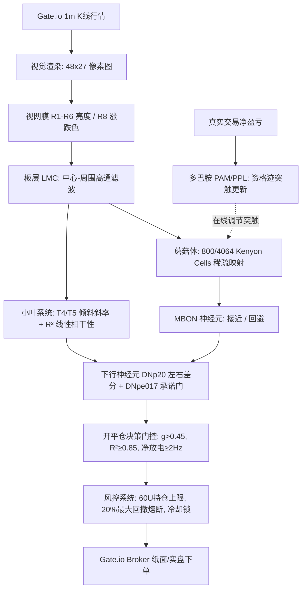

# FlyGate 深度剖析、果蝇网络商业变现路径与 GitHub 顶尖学习库指南

---

## 一、 FlyGate 项目核心架构与实测梳理

本项目 [flygate](file:///e:/Claude/github/flygate) 是一个将 **生物果蝇脑连接组（Connectome）与加密货币自动化量化交易** 结合的极客项目。



### 1.1 项目做对了什么（高价值工程资产）
1. **科学诚实的基准协议（Protocol）**：
   - 实现了严密的 **7 臂对照体系**（`normal` 学习蝇、`frozen` 冻结突触、`frozen_legacy` 旧门控、`random` 随机开仓、`buyhold` 暴露匹配基准、`rewired` 乱序打乱）。
   - 引入金融严谨统计学：`Deflated Sharpe Ratio (DSR)`、`PBO (过拟合概率)`、`MinTRL (最小显著序列长度)`、`HAC t 统计量`，完全封死了自欺欺人的“过拟合神话”。
2. **生物连接组数据工程已就绪**：
   - 在 [`真接线方案.md`](file:///e:/Claude/github/flygate/真接线方案.md) 和 `data/connectome/` 中完整拉取了 Janelia MaleCNS v1.0 全脑 16.6 万神经元、2500 万条突触边表，完成了细胞类型分类与路径可达性校验（K线光信号 2~3 跳即可到达蘑菇体）。
3. **高稳健交易风控与原子存储**：
   - 带有资金断电恢复、互斥引擎锁（`runs/engine.lock`）、冷却防抖与软硬件熔断机制。

### 1.2 为什么现阶段“靠它炒币”赚不到钱？（代码与回测的客观事实）
在深入推进前，必须看清项目代码与回测中早已暴露的核心事实：
1. **多巴胺在线学习通道是“钝化且有害”的**：
   - 设小门槛（<0.25×手续费）：1分钱的微观结构噪音在“教”大脑，把突触权重完全带偏，**越学越亏**。
   - 设合理门槛（1×往返手续费）：每天触发多巴胺事件仅 **0~5 次**，而突触遗忘率（Decay）是 30:1，导致**突触效能几乎为零，和冻结突触完全无异**。
2. **决策的本质只是一个简化的“均线倾斜检测器”**：
   - 代码实测表明：$DN_{\uparrow} - DN_{\downarrow}$ 净放电率与小叶输入斜率 $hs_{up} - hs_{dn}$ 的线性拟合度高达 $R^2 = 0.994$。也就是说，**昂贵的神经网络在 99.8% 的情况下仅仅退化为一个 15 行代码的趋势倾斜阈值**，蘑菇体只起到了开关的作用。
3. **被交易摩擦成本无情吞噬**：
   - 1m 级别的频繁微动，无法抵消 Gate.io 单边 0.2%（往返 0.4%）的手续费与滑点。在扣除摩擦和暴露匹配后，所有模型策略的 Alpha 均被手续费磨损殆尽。

---

## 二、 商业化变现思考：果蝇网络怎么真正赚钱？

果蝇在自然界中演化出的大脑，是为了解决：**在几毫瓦的极限功耗下，完成气味追踪、微秒级光流避障、3D空间定向与记忆**。
如果把果蝇网络直接当成“预测非平稳博弈市场的算命黑盒”，在数学上是南辕北辙；但如果**借用果蝇网络的核心机制解决实际工程与商业痛点**，有四个明确的赚钱方向：

```
                      ┌─── 1. 金融量化：模式检索器/投研社区/AI Agent Meme (快现)
                      │
果蝇网络商业变现矩阵  ├─── 2. 边缘电子鼻与工业安检检测 (高毛利硬件/B端)
                      │
                      ├─── 3. Fly-LSH 超高速高维向量检索 (AI算力节约/RAG加速)
                      │
                      └─── 4. 微型无人机/机器人极低功耗自主导航 (具身智能/国防工业)
```

### 变现方向 1：金融量化赛道的务实改造（快速变现/个人开发）
如果依然想做交易赚钱，不要端到端用脉冲神经元去预测下一根K线是涨是跌，而是做架构重构：
- **模式 A：FlyLSH 相似行情极速匹配（Pattern Matching）**：
  - 用果蝇蘑菇体稀疏编码（KC 展开）把 48×27 的历史走势切片压缩为 **稀疏二进制哈希码**。
  - 在百万级历史 K 线库中做毫秒级“最相似暴跌/暴涨前夕”的检索，为传统量化策略提供高置信度的环境状态特征（Market Regime）。
- **模式 B：AI Agent + 极客文化变现（Web3 / 开源社区溢价）**：
  - “AI果蝇自主炒币”在加密社区（Twitter/Farcaster/Solana/Pump.fun）具有极强的叙事爆发力（如同早期的 Truth Terminal、StonkFly）。
  - 可以搭建实况 24 小时直播控制台（Web UI），通过做**量化研究内容、策略跟单收费、或者发行研究型生态 Token** 赚取第一桶金。

### 变现方向 2：边缘电子鼻（E-Nose）与气味识别（B端硬件商业化）
- **核心逻辑**：果蝇蘑菇体（MB）在生物界就是专门用来闻气味的。当前工业界正在爆发“低功耗电子鼻”需求。
- **赚钱场景**：
  - **食品生鲜冷链监控**：水果/肉类变质产生的微量挥发物（VOC），果蝇网络用几十个传感器就能完成高灵敏分类。
  - **锂电池热失控预警**：电池在起火前几分钟会析出微量特征气体，利用果蝇嗅觉网络做极低漏报率检测。
  - **参考标杆**：Osmo（Google Ventures 领投）、Aryballe（类脑气味芯片）、Intel 神经拟态实验室（Loihi 芯片上运行果蝇嗅觉模型）。

### 变现方向 3：Fly-LSH 高维向量检索（大模型与数据基础设施）
- **核心逻辑**：2017 年 Salk 研究所发表于《Science》的经典论文证明：果蝇嗅觉网络（ORN→PN→KC）所采用的“维度随机扩张（6倍~20倍）+ 赢者通吃（WTA）稀疏化”，在数学上是一种**超越传统随机高斯投影的最高效 LSH（局部敏感哈希）**。
- **赚钱场景**：
  - 大模型 RAG 向量数据库的极速初筛索引（比 HNSW 内存占用低数倍）。
  - 电商/反作弊高维稀疏特征的毫秒级近似最近邻（ANN）检索服务。

### 变现方向 4：微型无人机/机器人极低功耗导航与避障（具身智能）
- **核心逻辑**：果蝇中央复合体（Central Complex, CX）包含环形吸引子（Ring Attractor）和罗盘神经元（EB-PB 通路），几百个神经元即可实现无 GPS 环境下的死算航位推算（Path Integration）与光流防撞。
- **赚钱场景**：
  - 仓储微型巡检无人机、地下管道机器人、微型侦察机。传统 SLAM 需要几千元的高性能 GPU/CPU，果蝇网络可以在几块钱的 MCU/边缘芯片上运行。
  - **参考标杆**：**Opteran Technologies**（英国初创公司，融资超 1200 万美元，核心产品就是把果蝇/蜜蜂的大脑逆向工程为无人机导航芯片）。

---

## 三、 GitHub 优质开源项目深度精选

以下精选仓库涵盖**量化交易落地**、**果蝇生物大脑基准**、**高维快速算法**与**微型具身智能**四大类：

### 类别 1：量化交易工程与统计学（解决 FlyGate 核心短板）

| 仓库 | 核心星级 | 许可证 | 学习重点与可复用模块 |
|---|---|---|---|
| [stefan-jansen/machine-learning-for-trading](https://github.com/stefan-jansen/machine-learning-for-trading) | ★21k+ | MIT | **必读**。量化防止过拟合的数学圣经。重点抄其 `16_strategy_simulation/` 中的 **Deflated Sharpe (DSR)**、**PBO(CSCV)**、**Purged Cross-Validation** 纯 numpy 实现，直接接入 flygate 验证任何模型是否有真实 Alpha。 |
| [nftechie/stonkfly](https://github.com/nftechie/stonkfly) | ★社区知名 | MIT | **FlyGate 的直接灵感来源**。同样基于 MaleCNS 连接组做加密货币交易。重点学习：`rule.py`（抗 Hebbian 规则）、`visual.py`（真实果蝇复眼六角网格像素映射）、`kernel.cpp`（事件驱动 C++ LIF 脉冲网络内核）。 |
| [jesse-ai/jesse](https://github.com/jesse-ai/jesse) | ★8.6k | MIT | **解决回测真实性**。重点学习：`candle_service.py::split_candle`（日内切分真实的滑点与止损价格）、无未来函数的边界防御 `candle[0]+60_000 <= available_at`。 |
| [freqtrade/freqtrade](https://github.com/freqtrade/freqtrade) | ★55k | GPL-3.0 | **最成熟的实盘架构**。参考其 FreqAI 的“滑动窗口增量重训（Rolling Retrain）”与“三重信任门”，把不可靠的单步多巴胺改造成基于区间的自适应调节。 |

---

### 类别 2：果蝇真实连接组、脑建模与类脑计算

| 仓库 | 核心亮点 | 推荐学习内容 |
|---|---|---|
| [cobanov/awesome-fly](https://github.com/cobanov/awesome-fly) | **果蝇连接组总导航** | 汇集了全球 FlyWire、MaleCNS、FAFB 的所有开源模型、数据载入器与仿真环境，进入该领域的第一站。 |
| [philshiu/Drosophila_brain_model](https://github.com/philshiu/Drosophila_brain_model) | **完整成年果蝇全脑 LIF 模型** | 基于 FlyWire 全脑连接组的 Brian2 脉冲网络仿真器。最珍贵的是**仓库自带处理好的 `Connectivity_783.parquet`（约 100MB）**，无需下载几十 GB 原始电镜文件即可模拟全脑神经元放电。 |
| [TuragaLab/flyvis](https://github.com/TuragaLab/flyvis) | **Nature 2024 顶刊成果** | 将真实视觉连接组约束与端到端任务学习相结合的标杆项目。代码质量极高，展示了如何用神经解剖学网络处理视觉光流任务。 |
| [eonsystemspbc/fly-brain](https://github.com/eonsystemspbc/fly-brain) | **13.8万神经元的大规模GPU仿真** | 支持 PyTorch / Brian2 / NEST-GPU。如果想把 FlyGate 从单核 CPU 推进到高并发 GPU 突触计算，可参考其并行边表设计。 |

---

### 类别 3：果蝇稀疏编码与快速哈希检索（算法变现最佳切入点）

| 仓库 | 算法原理 | 适用场景 |
|---|---|---|
| [dataplayer12/Fly-LSH](https://github.com/dataplayer12/Fly-LSH) | **Science 2017 Fly-LSH 经典复刻** | 将低维密集特征通过随机稀疏权重投影到 20 倍高维空间，再通过 WTA（Winner-Take-All）竞争抑制保留 top 5% 产生二进制指纹。比标准高斯 LSH 快且准。 |
| [tian-kun/Fly-LSH](https://github.com/tian-kun/Fly-LSH) | **嗅觉网络嗅觉编码器** | 纯 Python/NumPy 极简实现，代码仅几百行，极易直接移植并整合到 FlyGate 的图表特征提取中。 |
| [minimalparts/SemanticHashingFFA](https://github.com/minimalparts/SemanticHashingFFA) | **果蝇算法做文档语义哈希** | 对比了深度学习二值网络与果蝇算法在大规模文本检索中的性能，适合拿来做长文本/时序切片的快速相似度聚类。 |

---

### 类别 4：果蝇微型导航与机器人具身控制（无人机/机器人方向）

| 仓库 | 应用方向 | 技术要点 |
|---|---|---|
| [XuelongSun/I2Bot](https://github.com/XuelongSun/I2Bot) | **多模态昆虫导航工具箱** | 3D 虚拟环境中模拟昆虫视觉、气味羽流追踪与风向导航的综合系统，包含完整的中央复合体（CX）转向决策网络。 |
| [XuelongSun/insectNavigationCX](https://github.com/XuelongSun/insectNavigationCX) | **中央复合体（CX）环形吸引子** | 纯粹的脑神经网络实现“罗盘定向与航位推算（Path Integration）”。只有几十个神经元，却能在断网、无卫星信号下实现自主返航。 |
| [TuragaLab/flybody](https://github.com/TuragaLab/flybody) / [flygym](https://github.com/NeLy-EPFL/flygym) | **物理引擎具身果蝇（MuJoCo）** | 结合物理刚体动力学与神经控制的闭环仿真，适合做机器人步态规划与微型仿生飞行器飞控。 |

---

## 四、 商业化赚钱落地路线建议（从近到远）

```
[阶段 1: 2~4周] 极客社区与内容商业化
   │  • 把 flygate 包装为可视化的 Web3/开源“果蝇操盘手”
   │  • 部署 24h 实时行情推演仪表盘，沉淀社群、打赏或技术顾问收入
   ▼
[阶段 2: 1~2个月] 算法变现 (时序检索与风控特征)
   │  • 剥离并封装 FlyLSH 模块：开发高速 K 线形态搜索引擎
   │  • 出售时序形态检索 API 或作为自己组合量化系统的输入特征
   ▼
[阶段 3: 3~6个月] 工业/硬件结合 (微型边缘应用)
   │  • 结合微型气体传感器阵列（MQ/SGP系列），移植果蝇嗅觉网络做气味分类
   │  • 面向智慧农业（粮仓霉变、温室异味）或电池安全提供低成本检测盒
```
