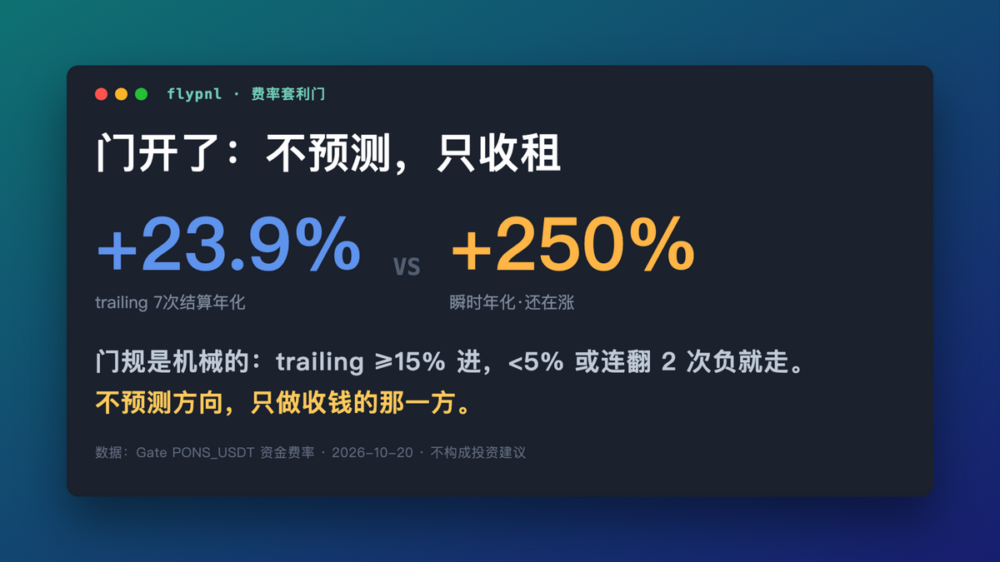

# 2026-10-20 — Day 1: the gate just opened

> 成品稿。发布后把互动数补在这里：EN likes/RT：___ ｜ 中文阅读：___

发推时拖入这张文件：`charts/gate-card.png`（1200×675）。第二张图可用 `charts/retina-compare.png`

---

## 🧵 EN main thread

**1/**
Day 1 of flypnl.

My fly brain has no directional edge — my own protocol proved that with
control arms and DSR statistics. I published the failure anyway.

But the funding-carry gate just opened on Gate: trailing 7 settlements
+23.9% annualized, spot rate +237%. Here's what discipline looks like. 🧵

**2/**
The gate rule is mechanical: enter only when trailing-7 ≥ 15% APR, exit when
it drops below 5% or flips negative twice. No prediction. Just getting paid
to be the liquidity the market is begging for.

[配图：charts/retina-compare.png]

**3/**
The part most people skip: my last backtest of this exact strategy on this
exact exchange costs 0.6% round trip. At current rates that's ~3 days of
funding to break even. So the pilot is $40 spot + $60 margin of groceries
money, with the exit lines published BEFORE entry, not after.

**4/**
What you'll see here weekly: the fly's paper equity (still no edge),
the carry gate state (open/closed/retreated), and an A-share momentum
signal currently saying "cash" while its market falls 20-38%.

No calls. No shilling. Losses included. Not financial advice.

---

## 中文副本

我用果蝇大脑炒币的第 1 天。先说结论：它没有方向性 edge，我自己的
测量协议（对照组+DSR统计）证明的，失败数据我照发。

但费率套利的门刚才开了：trailing 7 次结算年化 +23.9%，瞬时 +237%。
门规是机械的：trailing≥15% 才进，<5% 或连翻 2 次负就走。不预测，
只做收钱的那一方。

这次试点是买菜钱的量级：40U 现货 + 60U 保证金，撤退线在进场前
就公开。这个账户来回成本 0.6%，当前费率下约 3 天回本——数学不
性感，但纪律性感。

[配图：左边是你看的K线，右边是我的蝇看到的一切——48×27 像素]

不构成投资建议。亏损照发。

---

## 标签建议
#buildinpublic #algotrading #quant
