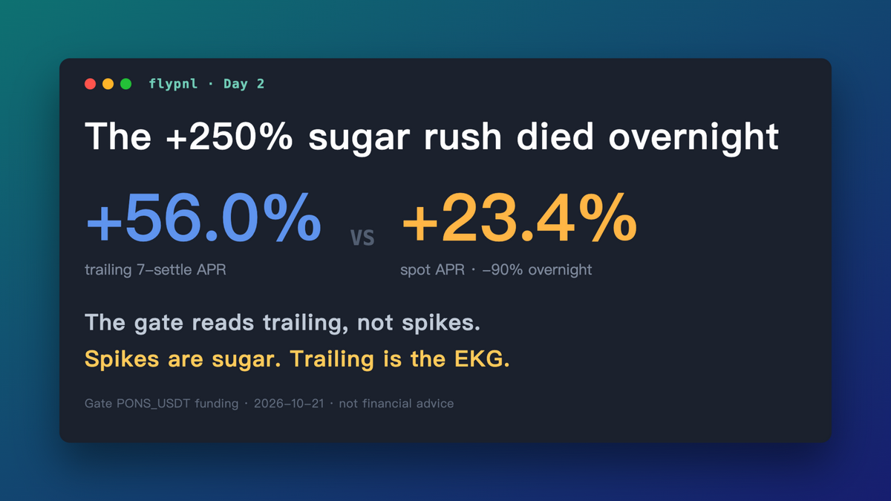
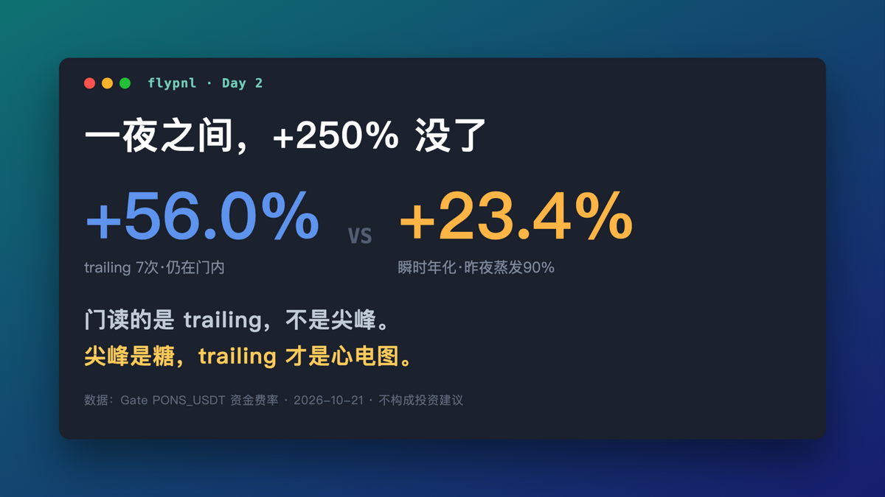

# 2026-10-21 — Day 2: the sugar rush died overnight

> 成品稿。EN 帖配 `charts/gate-card-d2-en.png`，中文副本配 `charts/gate-card-d2-cn.png`。
> 发布后补互动数：EN likes/RT：___ ｜ 中文阅读：___

---

## 🧵 EN main thread

**1/**
Day 2 of flypnl.

Overnight, the funding rate I was watching did this:
+250% APR → +23% APR. A 90% collapse while I slept.

This is exactly why my entry gate doesn't read the spot rate.
It reads trailing-7 settlements. That number went UP: 24% → 56%. 🧵

**2/**
Spot funding rate is a sugar rush. Memecoin hype can 10x it in an
evening and vaporize it by breakfast — it's the price of THIS settlement,
driven by whoever is desperate for leverage right now.

Trailing-7 is the average of the last 7 settlements, annualized.
An EKG, not a pulse spike.

**3/**
My entry rule: trailing-7 ≥ 15% APR. Never the spot rate.

Do the ugly math: my round-trip cost on this exchange is 0.6%.
Collecting at +23% APR ≈ 0.06%/day → ~9 days to break even.
Collecting at the spike's +250% would've been <1 day — if it held.
It didn't hold. Chasing spikes is how you buy top-tick funding.

**4/**
Gate status this morning: trailing +56% (the fat settlements rolled
INTO the window), marginal rate +23%. Both above water, gate open.

Pilot sizing unchanged: 40/60/50, exit lines published before entry —
trailing <5%, two negative settles in a row, or a 2% leg move. No
position yet. Moving slowly on purpose.

**5/**
Meanwhile the other leg: my A-share momentum account sits at 50%
Nasdaq ETF, 50% cash, +0.00% on the month — while its home market
fell 20%+.

Boring is the point. Weekly data continues. Not financial advice.

---

## 中文副本

Day 2。昨晚我盯的那个资金费率干了件事：年化 +250% → +23%，
睡一觉蒸发 90%。

这正是我的入场门不读瞬时费率、只读 trailing 7 次结算的原因——
那个数反而涨了：24% → 56%。肥的结算滚进了窗口，尖峰滚出视线。

算笔丑账：这个所来回成本 0.6%。按 +23% 年化收，约 9 天回本；
按尖峰的 +250% 收，不到 1 天——前提是它撑得住。它没撑住。
追尖峰就是在费率顶部接盘。

今早门的状态：trailing +56%，门开着；40/60/50 试仓方案不变，
撤退线进场前就挂好（trailing<5% / 连 2 次负 / 单腿 2%）。
还没进场，故意慢。

另一条腿：A股动量账户 50% 纳指 + 50% 现金，一个月 +0.00%，
老家市场跌了 20%+。无聊就是重点。

每周发数据。不构成投资建议。

---

## 标签
#buildinpublic #algotrading #quant #fundingrate
