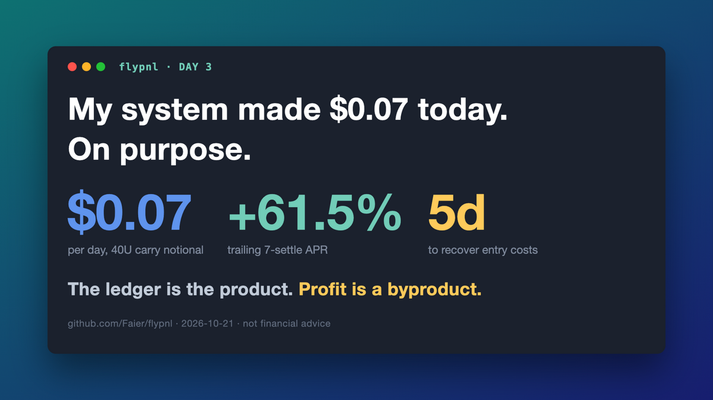
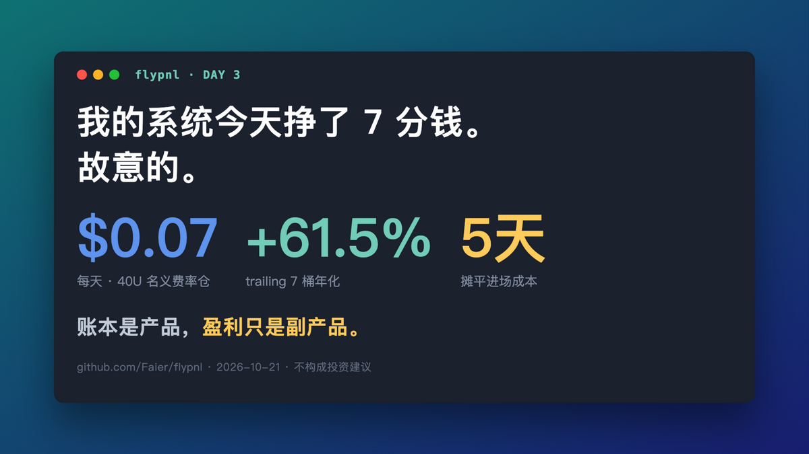

# 2026-10-21 — Day 3（晚）: 我的系统一天挣 7 分钱，故意的

> 成品稿。反虚荣数字钩子帖（模板 A 数字惊吓 × F 反共识）。
> EN 配 `charts/seven-cents-en.png`，中文配 `charts/seven-cents-cn.png`（蓝底数据卡系列）。
> 发布后补互动数：EN likes/RT：___ ｜ 中文阅读：___





---

## 🐦 EN 主推（weighted 278/280，直接复制）

```
My trading system made $0.07 today. On purpose.

150 USDT pilot, funding carry: long 40U spot + short 40U perp. Trailing 61.5% APR ≈ 7 cents a day.

Today: break-even gate (costs >7d = skip), maker-first entries, fixed a bug dropping 1 of 6 settlements.

The ledger is the product. Profit is a byproduct.

github.com/Faier/flypnl 🪰 NFA.
```

发推拖入图片：`charts/seven-cents-en.png`（1200×675）

---

## 中文副本

我的交易系统今天挣了 7 分钱。故意的。

150U 试点，费率套利：买 40U 现货 + 空 40U 永续，方向对冲。
trailing 7 桶年化 +61.5%，折下来一天约 7 美分。

今天上了三件东西：回本期门（成本摊不平 7 天就不进）、
maker 优先进场（省过桥费）、修了个 bug——它在悄悄漏记每 6 桶结算里的 1 桶。

账本是产品，盈利只是副产品。

github.com/Faier/flypnl
不构成投资建议 🪰

配图：`charts/seven-cents-cn.png`

---

## 数字依据（可审计）

- trailing 7 桶 +61.5%（gate_watch 10-21 21:07，62 桶历史）
- 40U 名义 × 61.5% ÷ 365 = $0.067/天 → "$0.07"
- 回本期：0.8% taker 往返 ÷ 0.168%/天 ≈ 5 天（maker 后 ≈3 天）
- bug：carry 旧版 last_settle = 进场+interval，漏记进场后第一次结算
  （4h 桶 = 每天 6 桶 → "1 of 6"），c9e06f7 修复
- 红线自查：无喊单、无绝对余额（150U 为已公开 pilot 规模）、亏损照发口径保留

## 标签

#buildinpublic #algotrading #quant #fundingrate
