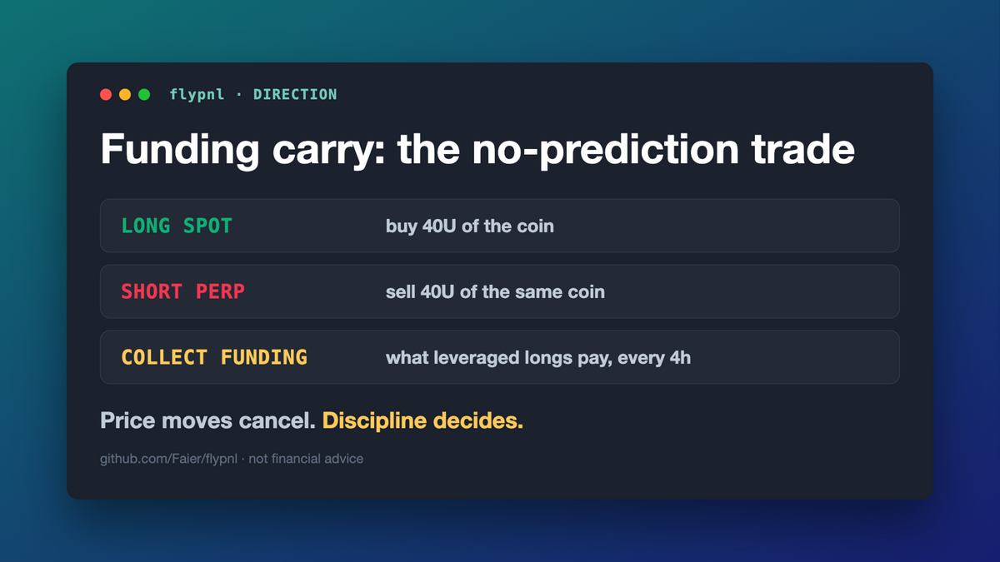
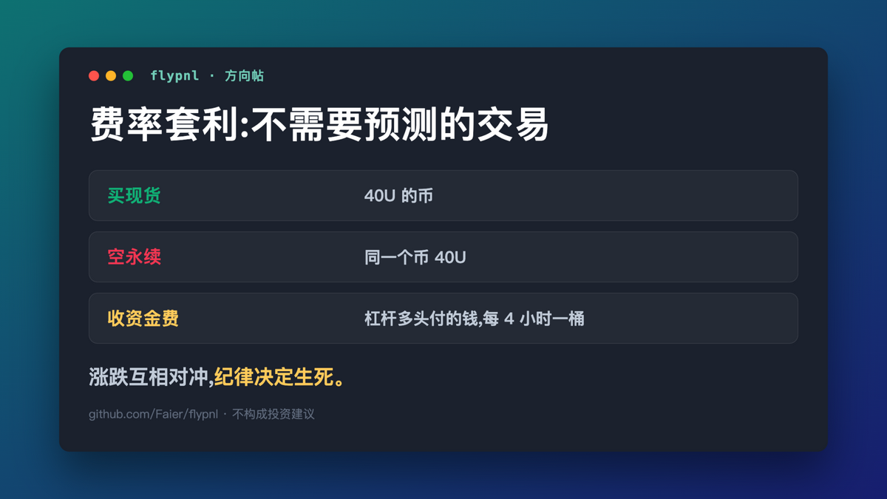

# 2026-10-21 — 方向帖: 费率套利,不需要预测的交易

> 成品稿。直接给方向的干货输出帖（区别于同日的 7 分钱自嘲帖——那条是钩子，
> 这条是立方向的支柱内容，可以隔天发）。
> EN 配 `charts/carry-direction-en.png`，中文配 `charts/carry-direction-cn.png`。
> 发布后补互动数：EN likes/RT：___ ｜ 中文阅读：___





---

## 🐦 EN 主推（weighted 270/280，直接复制）

```
Funding carry: the first real-money trade I trust. You predict nothing.

Long 40U spot + short 40U perp — price moves cancel; you collect what leveraged longs pay every 4h.

Rules: enter trailing APR ≥15%, exit <5% or 2 negatives. 0.8% round trip kills most attempts.

Every fill published: github.com/Faier/flypnl 🪰 NFA.
```

发推拖入图片：`charts/carry-direction-en.png`（1200×675）

---

## 中文副本

费率套利：我第一个敢上真金的交易。它不需要你预测任何事。

买 40U 现货 + 空 40U 永续，同一个币——涨跌互相对冲掉，
你收的是杠杆多头每 4 小时付的钱。

规则全是机械的：trailing 年化 ≥15% 才进，<5% 或连续 2 桶翻负就走。
来回 0.8% 的成本杀死大多数尝试——这就是纪律存在的原因。

每一笔成交都公开：github.com/Faier/flypnl
不构成投资建议 🪰

配图：`charts/carry-direction-cn.png`

---

## 发帖策略备注

- 与 day3 七分钱帖错开发（建议隔天）,一钩子一支柱
- 本条定位:支柱/立方向,适合置顶回复或以后串进 thread
- 红线自查:无喊单(说的是结构不是标的)、无绝对余额承诺、NFA 在

## 标签

#buildinpublic #fundingrate #algotrading #quant
