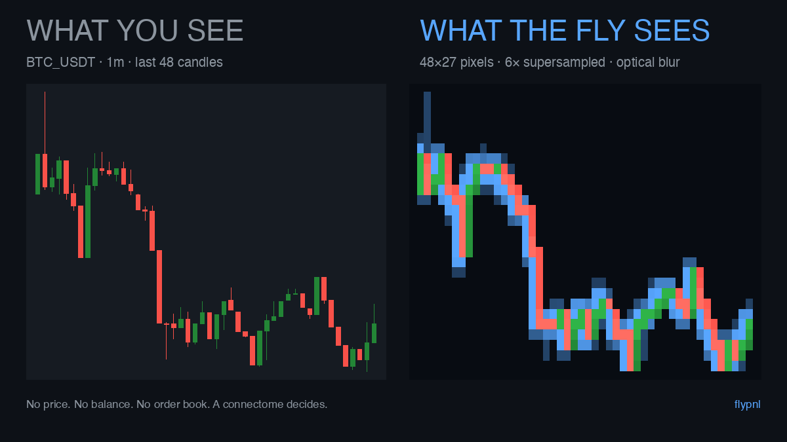

# 2026-10-21 — Launch / Day 0: 项目介绍推（转型后第一发）

> 成品稿。第一条项目介绍推：不甩数字，纯故事 + 概念图。
> 配图：`charts/retina-compare.png`（左：你看的K线；右：蝇看到的一切）。
> 发布后补互动数：EN likes/RT：___ ｜ 中文阅读：___
> 背景note：当天先发了一条过渡帖（感谢互关、宣布接下来以本项目为主），
> 本条紧随其后，作为"新内容方向"的第一条正式项目介绍。



---

## 🐦 EN 主推（直接复制，weighted 278/280）

```
I connected a fruit-fly brain to a crypto exchange.

Not a metaphor — a neural network wired from the real drosophila connectome. It watches charts the way a fly would: blurry pixels. No price, no balance, no order book.

It trades real money. I publish everything, losses included.

github.com/Faier/flypnl 🪰 Not financial advice.
```

发推时拖入图片：`charts/retina-compare.png`（1200×675）

---

## 中文副本（小红书/微信用）

我把果蝇的大脑接进了交易所。

不是比喻：一个用果蝇连接组真接线的神经网络。它看K线的方式和你我
完全不同——一片模糊的像素。没有价格，没有余额，没有盘口。

它拿真钱在交易。所有数据公开，亏损照发。

代码和数据：github.com/Faier/flypnl
不构成投资建议 🪰

---

## 内容方向备注（今天的判断）

- 蓝朋友式内容（感悟+互赞）只适合冷启动，没有差异化钩子换不来大曝光
- 本项目的钩子是稀缺题材：真连接组 + 真金白银 + 失败照发 + 连续剧结构
- 后续节奏按 content/WORKFLOW.md：每周 2–3 篇，"flypnl day/week N" 连载
- 向不同大佬学习排版/钩子写法，模板轮换见 content/templates.md（A–F）

## 标签

#buildinpublic #algotrading #quant #neurotwitter
